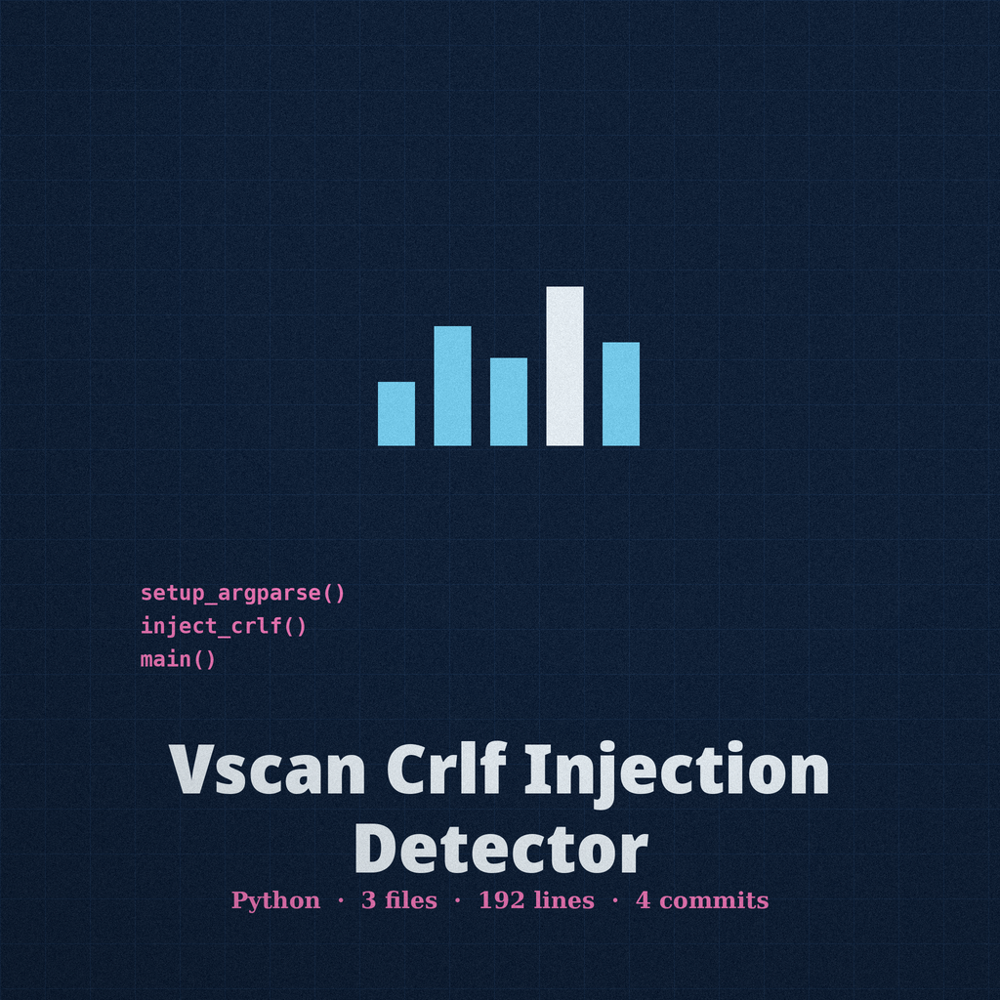
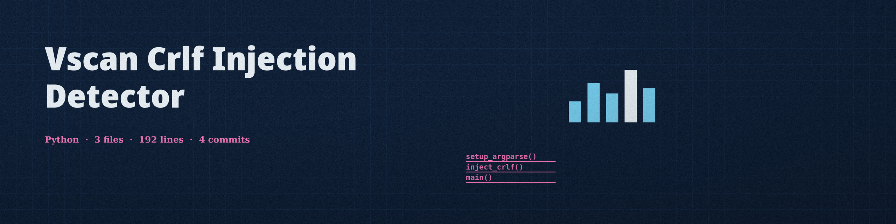

# vscan-crlf-injection-detector





Detects potential CRLF injection by appending a CRLF payload to parameter values and to custom header values and checking whether the injected header name appears in the response with the injected value in that same header. Parameters already present in the target URL query string are tested as well as parameters supplied with `-p`. All supplied parameters and headers are tested even after a finding. If a request fails, or no parameter or header test runs, the tool prints a failure line and exits non-zero instead of reporting a clean verdict.

## Install

```bash
git clone https://github.com/ShadowGuard-AI/vscan-crlf-injection-detector
cd vscan-crlf-injection-detector
pip install -r requirements.txt
```

## Usage

```bash
python3 main.py <url> [-p PARAMS] [-H HEADERS] [-crlf CRLF_PAYLOAD] [-t TIMEOUT] [--user-agent USER_AGENT]
python3 main.py "http://127.0.0.1:8000/search?q=test" -p "ref=home" -H "X-Test: value"
```

Headers supplied with `-H` may be separated by a literal `\n` or by real newline characters. Only use this tool against targets you are authorized to test.

## Parameters

- `url`: The URL to scan (positional, required)
- `-p`, `--params`: URL parameters to test (e.g. `param1=value1&param2=value2`)
- `-H`, `--headers`: Custom headers to include (e.g. `Header1: Value1\nHeader2: Value2`)
- `-crlf`, `--crlf_payload`: Custom CRLF payload (default `%0d%0a`)
- `-t`, `--timeout`: Request timeout in seconds (default 10)
- `--user-agent`: Custom User-Agent header

## License

MIT. See LICENSE.
